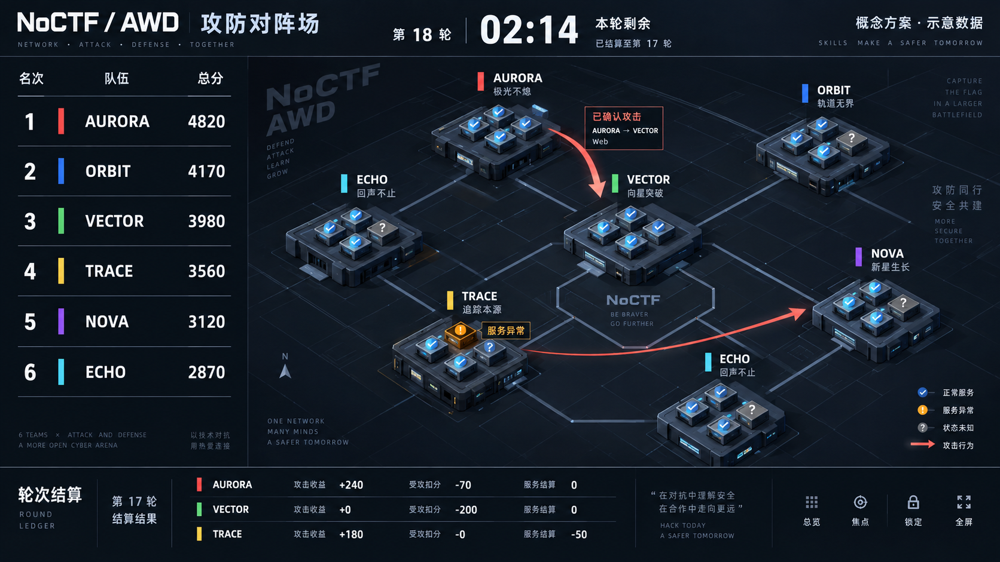
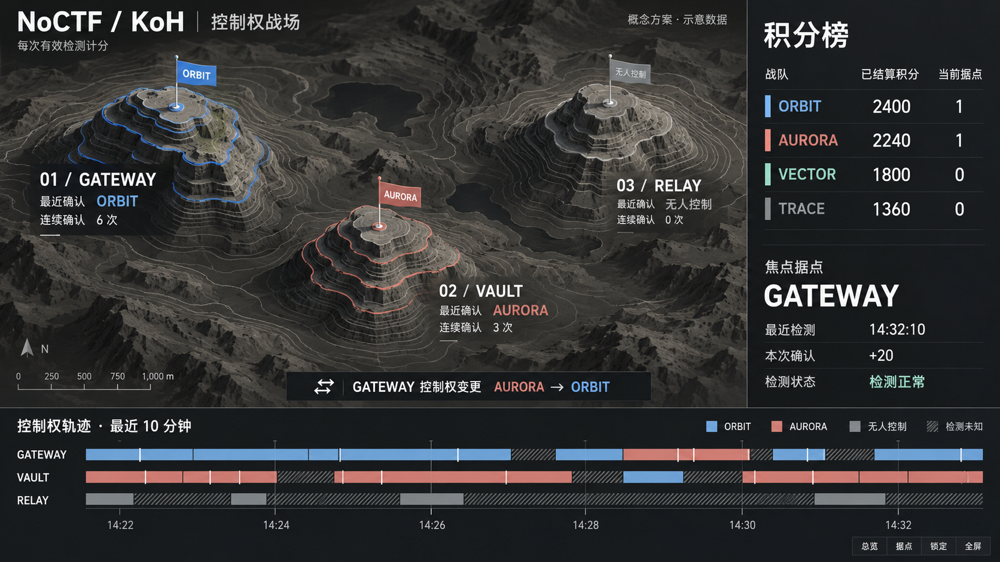

# AWD 与 KoH 观战大屏设计提案

状态：**视觉与实施方案已确认，开发中**。日期：2026-10-12。

工作分支：`codex/awd-koh-control-screens`；规划基线：`fb276b7037324d32bed98fc954a8619b9b564748`。

## 1. 已确认的任务边界

面向现场投屏和直播观战，兼顾导播切换。先交付完整规划与两套视觉方案，确认后开发。AWD 与 KoH 各自建立符合赛制的空间表达、信息结构和事件反馈。

观众最重要的任务：AWD 看懂谁攻击了谁、哪些宕机以及轮次得失；KoH 看懂每个据点由谁控制、控制权如何变化以及确认计分的结果。

本次交付为高保真概念图和实施设计；图中数据均为示意。应用交付范围建议为两条模式专属路由、总览与焦点视图、同浏览器导播控制、必要的只读数据接口、性能与权限验收。首版不包含跨设备远程导播、录播剪辑、历史整场重演、比赛裁定和运行时控制。

## 2. 赛制事实决定设计

| 维度 | AWD | KoH |
| --- | --- | --- |
| 场景中的主体 | 队伍，以及每支队伍的题目服务 | 题目据点，以及该据点的控制者 |
| 核心关系 | 攻击方 → 受攻方，按题目与轮次关联 | 据点 → 最近确认控制者，以及控制权转移 |
| 时间 | 加固阶段、服务检测、实际轮次与轮次结算 | 离散控制检测、确认序列和控制权变化 |
| 成绩解释 | 攻击收益、受攻扣分、服务结算，沿用后台规则 | 有效观测次数及其计分，加减其他合法调整 |
| 最重要的异常 | 宕机、状态未知、已攻击但积分尚未更新 | 无人控制、检测失败、状态过期必须分开 |

已核对的源码约束：

- AWD 支持固定攻击得分与多人平分受攻方防守分池。攻击去重涉及题目、轮次、受攻方和攻击方。共享分池下，后续攻击者可能改变此前攻击者的分配；不能用浏览器累加每次攻击的固定分数。
- AWD 服务状态与攻击结果是不同事实。一次成功攻击不等于服务宕机，缺少服务检测记录也不等于已确认健康。界面不制造血条、护盾耐久或未定义的修复分数。
- AWD 轮次取服务端实际轮次记录与状态；加固、暂停、恢复及晚发布题目必须遵循当前运行规则，不能只用比赛开始时间除以轮长计算。
- KoH 按 `KohControlObservation` 的确认结果和 `Multiplicity` 计分，不按浏览器连续经过的秒数计分。题目可具有不同分值；使用有效规则。
- KoH 的 `Uncontrolled` 与超时、不可用等检测失败不同。失败记录不能画成已确认无人控制，也不能凭空补发遗漏检测的积分。
- `ControlledChallengeCount` 是历史控制过的不同题目数量，不能用它显示当前控制的据点数量。
- 当前 KoH 投影还区分检测识别出的队伍与影响竞技结果的有效控制者。非竞技队伍的检测结果不一定替换有效控制者；新接口必须复用该规则，不能在前端另写一套。
- 公开大屏遵循公开计分板可见性、封榜时点、题目发布与队伍资格。操作者登录管理员账号也不能使播出画面自动升级成内部数据视角。

## 3. 共同视觉原则

场景句：导播在较暗的现场控制台切换画面，观众从远处 LED 屏或直播窗口观看，需要在几秒内辨认队伍、状态与结果。

采用专用深色、哑光场景，延续 NoCTF 的微软雅黑、明确状态和克制技术感。色彩策略为 Restrained：中性底色占主体，语义色只标记关系、状态与队伍身份。配色通过 `main.css` 专用语义 token 统一，WebGL 材质从所在大屏容器解析，不随个人品牌强调色改变含义。

主要文字在 1080p 基准下约 24–32px，关键信息 40–64px，辅助信息约 18–20px；比分使用等宽数字。布局保留约 3% 投屏安全边距。长队名提供有限换行和焦点完整名称，不使用连续跑马灯。

共享品牌标识、全屏、数据新鲜度、按钮与可访问交互；场景拓扑、核心指标和事件反馈分开实现。分区采用留白与细内嵌分隔，不叠加整屏毛玻璃和发光边框。

## 4. AWD 方案：攻防对阵场

### 布局与隐喻

参考 F1 计时塔的信息层级和电气单线图的定向关系；参考原则，不复制具体产品布局。

- 顶部约 10%：赛事名称、阶段、当前轮、剩余时间、已结算轮次与数据状态。
- 左侧约 23%：平面排名塔，显示队名、名次和权威总分；焦点队伍可以展开本轮分项。
- 中央及右侧：低矮的等距队伍阵地，阵地内模块对应题目服务。节点位置在刷新与排名变化时保持稳定；名次改变只影响排名塔。
- 底部约 18%：最近结算轮次的分项条带，区分攻击收益、受攻扣分、服务结算。异常调整存在时单列，避免三项相加与总分不一致。

钢蓝承担场景结构，珊瑚红承担已确认攻击方向，琥珀色承担宕机；未知状态灰色并带问号。队伍色条与状态色分开，箭头、图标和文字共同表达含义。

### 三种镜头

1. **全局攻防**：稳定阵地与有限数量的近期攻击连线，理解整体态势。
2. **队伍焦点**：固定一支队伍，展开其服务状态、入站/出站攻击与最近结算，其他队伍退为关系上下文。
3. **题目焦点**：观察同一题目在各队的服务状态及相关攻击，避免一张图叠加所有题目的连线。

首次打开只建立历史基线，不连续播放大量旧攻击。新确认事件显示攻击方、受攻方、题目和所属轮次；攻击动画与分数刷新独立。重复事实不重复播报，纠正后的事实更新结果，不伪装成一条新攻击。

动画约 0.8–1.2 秒，使用有方向的短弧与端点强调；不全屏爆炸，不改变相机追逐每条攻击。短时间同一关系合并显示次数，播报上限不影响真实统计。

### 数量适配

建议 2–12 队采用完整阵地，13–32 队采用紧凑节点并只展开焦点服务；更大规模按可见队组轮播，明确当前范围，跨组攻击保留完整双方文字。排名列表使用受控分页轮播，人工锁定后停止自动切换。题目服务过多时显示异常摘要及数量，题目焦点展示详细状态，不把所有模块挤进阵地。

### 概念图评审结论

保留排名塔、低矮服务阵地和轮次分项。实际实现去掉额外口号、装饰性英文、无意义方位标以及图中重复的 ECHO 节点；每个队伍 ID 只能对应一个节点。图中的默认健康勾选不得作为无数据时的默认态。

## 5. KoH 方案：控制权战场

### 布局与隐喻

参考等高线测绘图、建筑地形沙盘和体育转播的控球权时间线；空间围绕据点展开。

- 左侧约 70%：正交视角的分层据点地形。每块地形代表一道题目，其轮廓与位置固定；高度不伪装成分数或难度。
- 据点顶部：旗标/信标、题目名、最近确认控制者和检测状态；队伍颜色只出现在旗标及边缘轮廓。
- 右侧约 27%：已结算积分排名，以及当前焦点据点的有效计分规则、最近检测和确认结果。
- 底部约 18–20%：近期控制确认轨迹，每道题一条泳道，以颜色分段、离散检测标记及未知纹理呈现。

石墨与低饱和灰绿构成地形，米白正文。队伍使用稳定且可区分的有限色组，并一直显示名称。重复颜色时增加符号；不能仅凭颜色认队。

### 三种镜头

1. **据点总览**：谁控制哪些据点，以及哪些据点状态未知。
2. **据点焦点**：放大一个据点，展示控制者变化、连续确认次数和最近确认得分。
3. **队伍控制版图**：强调同一队伍当前有效控制的据点，显示各据点检测新鲜度及权威积分。

控制者真正变化后，旗标与轮廓色交接，随后显示“A → B 接管某据点”。同一控制者的新有效检测仅有一次轻量确认脉冲，不重复庆祝。确认无人控制时撤去队伍旗标；检测失败时保留最近确认信息，叠加“检测未知”，不宣称控制者已经改变。

“连续确认 N 次”限定为无失败中断的连续有效检测；恢复后的连续次数重新计起。时间线表达检测确认的状态区间，不能声称两次采样之间的实际控制权从未变化。失败区间使用斜纹。`当前据点`须依据服务端有效控制投影，同时注明未知/过期据点数量，禁止从累计得分推断。

检测失败时即使计分模型保留有效控制者，播出文字也必须标为“最近有效控制者”，不能继续显示“当前已确认”。非竞技队伍识别结果、有效控制者和积分归属存在差异时，使用明确且经过公开权限过滤的说明。

### 数量适配

1–6 个据点完整展示，7–12 个使用简化沙盘和重点标签，更多按据点组分页轮播，持续标出范围。时间线默认最近 10 分钟，切换 5/10/30 分钟按需查询；旧记录通过有界窗口读取，不能首屏下载全场历史。

### 概念图评审结论

保留据点、队旗、积分塔与控制轨迹。实际实现将地形改为低面数、少层级的程序化模型，移除图中的地理距离尺和无业务意义的写实山石。概念图的时间线与当前旗标只是绘制示意；验收必须保证同一快照下二者一致，未知段不能覆盖成连续持有。

## 6. 导播与观看交互

- 普通观众进入即为干净的播出画面；点击或键盘唤出控制条，聚焦期间不自动隐藏。提供总览、焦点、自动轮播/锁定、画质、减少动态效果、全屏和返回赛事。
- 单击队伍/据点仅切换本地镜头，不调用比赛写接口。选中状态与悬停状态分离，触屏和键盘可完成相同操作。
- 锁定镜头仍接收数据更新。暂停动画不暂停数据，也不暂停比赛。三个概念在文案与实现中明确分开。
- 自动轮播只在预设镜头间平稳切换，默认约 15 秒一页，交互后停止；不会因每条事件强制跳转。切页允许简单淡入，减少动态效果时直接切换。
- 查询参数保存赛道、焦点实体和镜头模式，刷新恢复；仅保存展示偏好，不携带凭据。无效/失去可见性的焦点恢复总览并告知原因。
- 首版导播与播出为同浏览器控制，配合浏览器窗口捕获。控制条可快捷隐藏；独立远程控制台、跨窗口同步及输出预览不计入首版承诺。
- 全屏覆盖浏览器支持、退出路径和焦点恢复；不接管页面默认滚轮。主播出画面不出现整页滚动条，长控制目录使用共享 ScrollSurface。

## 7. 数据接口与安全边界

现有排行榜可复用排名与积分；现有通用事件接口不能单独承载新场景：AWD 攻击关系缺少完整受攻方字段，KoH 检测事件目前属于 Staff 可见范围。不得把内部事件接口直接暴露给观众，也不得逐队逐题轮询格子详情构建全场。

建议在 Application 增加模式专属只读观战投影，由 API 以强类型 FastEndpoints 公开经过可见性裁剪的结果。优先从既有事实、轮次与计分逻辑投影，不新增另一套业务分数或控制权持久化事实。

| 数据契约（设计草案） | 必需内容 |
| --- | --- |
| 共用快照 | 赛事与模式、公开可见性、生命周期、快照版本、数据截止时间、服务器时间、有效筛选范围、公开队伍身份与排名 |
| AWD 场景 | 加固/轮次上下文、队伍服务状态及最近检测时间、已确认攻击双方/题目/轮次、权威分项、最近结算上下文 |
| KoH 场景 | 各据点最新检测状态、最近确认与有效控制者、有效计分规则、已确认次数/分数、状态时间、当前有效控制据点统计 |
| 有界变化/历史 | 不透明游标、稳定事实或事件标识、版本与发生时间、可见的更新/撤销语义、是否还有记录、窗口起止 |

接口名称与最终字段在实现阶段定稿；有界业务状态使用 enum/value object，前端 SDK 从 OpenAPI 生成。公开响应不含 Flag、Token、检测 URL、容器地址、内部失败细节或私人身份。

更新流程：初次读取快照与有限近期变化 → SignalR 仅通知失效 → 合并请求并单飞回读 → 校验版本后原子替换展示。使用低频兜底刷新；重连补查缺口，游标失效时重新建立快照，不重播整场。队伍身份、比分、关系和轨迹以同一版本/截止时间对齐，不能一半新一半旧。

公开封榜时，场景、动态、据点控制和积分全部遵循允许的截止时间；不能只冻结排名而继续泄露控制或攻击。公开隐藏时退出数据展示，清理当前受保护场景。权限被收回时也不能继续保留旧内部数据。展示账号是否有管理权限不改变这些原则。

如果近期窗口不足以确定控制者或连续确认起点，服务端读取窗口之前的必要边界状态；不允许前端用“最新十条”反推全局。历史聚合结果按窗口返回，记录上限和时间分辨率显式可知。

## 8. 必须覆盖的状态

| 状态 | 播出行为 |
| --- | --- |
| 首次加载 | 保留赛事身份与结构，明确正在读取，不显示假比分/随机节点 |
| 未开始/加固 | 呈现阶段，停止攻击播放；时间只源于有效赛程 |
| 暂停 | 显示暂停与数据截止；停止业务倒计时和预期检测推演 |
| 运行中但无新事件 | 保持安静，现状仍可读，无循环制造攻击或接管 |
| 已结束 | 展示最终可公开快照和结束状态，可手动查看既有轨迹 |
| 封榜/隐藏 | 明示冻结截止或不可查看，不借动态泄露新状态 |
| 断线/刷新失败 | 保留最后成功的公开快照，显式标过期及时间，不继续跳分 |
| 检测失败 | 区分宕机与平台检测未知；KoH 区分无人控制与未知 |
| 无队伍/无题目 | 使用业务空态，控制条可返回赛事，不生成装饰假数据 |
| 并列/长名称/超量实体 | 沿用后端排名与资格，稳定布局，显式分页范围 |
| WebGL 不可用/上下文丢失 | 自动切换可读的 2D 拓扑/据点列表，保留数据与控制 |
| 减少动态效果 | 静态关系和轨迹，状态即时更新，不绕场、不脉冲 |

## 9. 性能与可读性验收计划

以下为待实测的预算，不是已达到的性能声明。

- 默认 30 FPS，上限 60 FPS 为选项；DPR 建议封顶 1.5。优先使用共享几何体、实例化与有限材质，无整屏 Bloom、实时多光源阴影、深度模糊或无限粒子。
- 场景空闲时按需绘制；有事件/镜头过渡时才启动有限动画。隐藏页面停止绘制与非必要轮询；恢复后先校准快照。
- WebGL 渲染帧不触发整棵 Vue 响应式更新；DOM 标签在数据或相机变化时批量更新。指针射线检测最多每动画帧一次，无移动不检测。
- AWD 同屏活动攻击线建议最多 12 条，播放队列最多 30 条，突发事件合并/摘要；底层统计不丢。近期记录按有界窗口读取，过期对象、纹理、订阅和 RAF 完整释放。
- KoH 仅绘制可见时间范围的聚合段与检测标记，不为全部历史创建 DOM。多队多题采用分页/聚合，禁止随比赛时长无限增长。
- 验收负载：AWD 32 队×8 题及每秒 20 条事件的模拟突发；KoH 12 据点×64 队及快速切换窗口。以上是压力用例，不代表真实部署规模上限。
- 在同一台设备记录浏览器、CPU/GPU、分辨率，比较静止、持续更新、导播切换和 15 分钟稳定运行。30 FPS 模式活动帧 p95 目标 ≤33.3ms；稳定阶段避免新增超过 50ms 的主线程长任务。记录内存曲线、布局/绘制成本和进程 CPU，超过预算时主动降低实体密度与渲染比例。
- 检查 1920×1080、2560×1440、3840×2160 和 16:10；4K 文字保持清晰但 3D 不强求原生 4K。窄屏切换二维布局，不把完整大屏缩成不可读的小字。
- 验证中英文、超长队名、键盘焦点、非颜色状态、减少动态效果和全屏退出。播出主数字和标签不依赖鼠标悬停才能理解。

## 10. 开发分层与原子提交顺序

1. **观战数据投影与契约**：复用权威计分规则，补充公开 AWD/KoH 场景与有界历史查询、可见性与版本一致性测试、生成 OpenAPI/SDK。若改动消息处理器依赖，按仓库规则重新生成 Wolverine adapters。
2. **共同观战基础**：数据单飞/失效重取、镜头选择、全屏、自动轮播、数据状态、降级与动态效果预算。只共享真正相同的基础行为。
3. **AWD 场景**：服务阵地、攻击关系、焦点模式与轮次分项，包含独立 Mock 与边界场景。
4. **KoH 场景**：据点地形、控制权交接、离散确认与有界轨迹，包含未知状态与非竞技队伍语义。
5. **入口和验收**：按赛制接入现有“3D 大屏”入口，桌面/全屏/缩放/键盘实测、性能录制及回归。

建议路由 `/competitions/:id/awd-live` 与 `/competitions/:id/koh-live`，与既有大屏并列且使用明确模式门禁。最终入口名称统一为“观战大屏”，按比赛模式分派。

前端逻辑置于 `features/control-screens/` 的模式子域，纯渲染在 `components/views/`，共享 UI 在 `components/ui/`，动效在 `motion/`，Three 场景在职责明确的 `lib/` 模块。静态 SVG 沿用资源目录，中英文采用语义 key；不依赖 LiveSolo 媒体模块。

实现时执行 `bun run typecheck`、`bun run audit:architecture`、相关行为测试和真实浏览器验收。后端采用 TUnit；关系投影、权限和并发需真实 PostgreSQL 集成验证，不能以 EF InMemory 替代。规划提交本身不改应用代码，不运行无关构建。

## 11. 验收清单

- 两种模式的主视觉实体分别是队伍服务阵地和题目据点，观众可直接说出两者不同的竞技目标。
- AWD 已确认攻击方向正确，刷新/重连不重复播放，攻击不伪装成宕机或固定即时加分。
- AWD 加固/暂停/恢复/结算时点与服务端一致；分项与总分可解释。
- KoH 控制、无人控制、检测未知明确区分；无确认时不增长分数、不延长已确认持有事实。
- KoH 当前据点数、控制轨迹与有效控制者同版本；历史占领数不冒充当前数。
- 冻结/隐藏和身份权限切换不能泄露比公开计分板更新或更私密的数据。
- 自动轮播可锁定，操作不会写入比赛状态，焦点和键盘选择一致。
- 无事件、超量实体、历史窗口切换、长名称和 WebGL 降级均可用。
- 15 分钟压力运行没有随历史增长的内存/DOM/动画队列膨胀；实测性能达到预算或有明确降级结果。

## 12. 待确认与实施参考

本提案推荐同时采用 AWD“攻防对阵场”和 KoH“控制权战场”，并按上文概念图评审结论收敛。用户已批准最终视觉方向，不修改全站已批准 DESIGN.md。

需要用户确认的是两种视觉方向与首版边界。实际现场设备、最大队伍/据点规模和是否需要跨设备导播可在开发前补充；未补充时按本提案的压力用例与同浏览器控制推进，不预先扩大范围。

实现时重点参考 impeccable 的空间布局、交互、动效和可访问性指导，以及仓库 AGENTS.md、ClientApp/AGENTS.md、PRODUCT.md、DESIGN.md；规范冲突以当前 AGENTS.md 与明确用户要求优先。

源码核对入口（相对仓库根目录）：

- [模式配置](../../backend/src/NoCTF.Domain/Competitions/CompetitionModeConfiguration.cs)
- [AWD 与 KoH 计分投影](../../backend/src/NoCTF.GameModes/Leaderboard/ModeLeaderboardProjectors.cs)
- [标准计分板轮次投影](../../backend/src/NoCTF.GameModes/Leaderboard/NormalizedScoreboardProjection.cs)
- [计分板契约](../../backend/src/NoCTF.Application/Scoring/Leaderboard/LeaderboardModels.cs)
- [KoH 检测及落库](../../backend/src/NoCTF.Worker/KohMessageHandlers.cs)
- [KoH 检测协议](../../backend/src/NoCTF.Application/Competitions/Koh/KohControlPolling.cs)
- [公共事件读取](../../backend/src/NoCTF.API/Endpoints/Competitions/Events/ListCompetitionEventsEndpoint.cs)
- [公开计分格明细](../../backend/src/NoCTF.API/Endpoints/Competitions/GetScoreboardSlotDetailEndpoint.cs)

两张概念图使用内置 imagegen 生成，仅用于设计评审，非已运行界面。提示词见 [visual-prompts.md](visual-prompts.md)。

